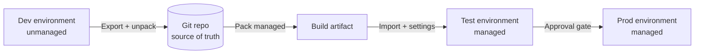

# Power Platform ALM Pipelines


Automated **application lifecycle management** for Power Platform: source-control solutions in Git and deploy them **Dev → Test → Prod** as **managed solutions**, with **environment variables** and **connection references** configured per environment.

> Generic, reusable templates based on the deployment process I run on enterprise projects. Environment names and IDs are placeholders.

## 🔁 Flow



## 📁 Structure

```
├── azure-pipelines/
│   ├── export-solution.yml        # Dev → Git
│   └── build-and-deploy.yml       # Git → Test → Prod (multi-stage)
├── .github/workflows/
│   └── export-solution.yml        # Same export using GitHub Actions
├── deployment-settings/
│   ├── test.json                  # Env variables + connection refs for Test
│   └── prod.json
└── solutions/                     # Unpacked solution source
```

## ⚙️ Setup

1. **App registration** in Microsoft Entra ID (client ID + secret).
2. Add it as an **application user** in each environment with the System Administrator role.
3. **Azure DevOps:** install the *Power Platform Build Tools* extension and create a service connection per environment (`PP-Dev`, `PP-Test`, `PP-Prod`).
4. Create Azure DevOps **environments** `Test` and `Prod`, and add an approval check on `Prod`.
5. Generate a settings file for your solution:
   ```bash
   pac solution create-settings --solution-zip CaseManagement_managed.zip --settings-file deployment-settings/test.json
   ```
   Fill in the values per environment.

## ✅ Practices

- **Unmanaged in Dev, managed everywhere else** — no direct edits in Test/Prod
- **Environment variables** for URLs, site addresses and IDs that change per environment
- **Connection references** so flows bind to the right connections on import
- Solution unpacked into Git, so every change is reviewable in a pull request
- Approval gate before production

## 👤 Author

**Pavan Reddy Cheedeti** — Power Platform Developer · [LinkedIn](https://www.linkedin.com/in/pavan-reddy-ch-a960b7439/)
